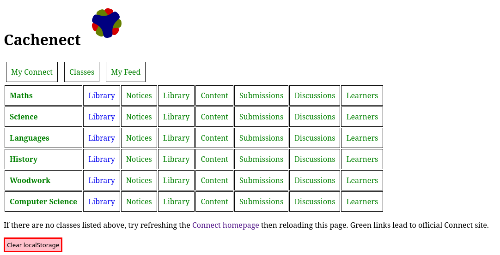

# cachenect

Firefox-**only** extension to cache connect (connect.det.wa.edu.au) data and present it in an alternative view.
Multi-user support is not planned.

## Installation

1. Download this repo as a zip and extract it somewhere
2. Head to [about:debugging#](about:debugging#/runtime/this-firefox)
3. Select "This Firefox"
4. "Load Temporary Add-on" -> Select manifest.json from the extracted zip (any other file in the root of the repo should also work)
